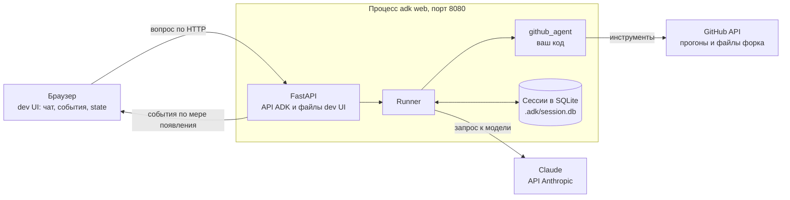
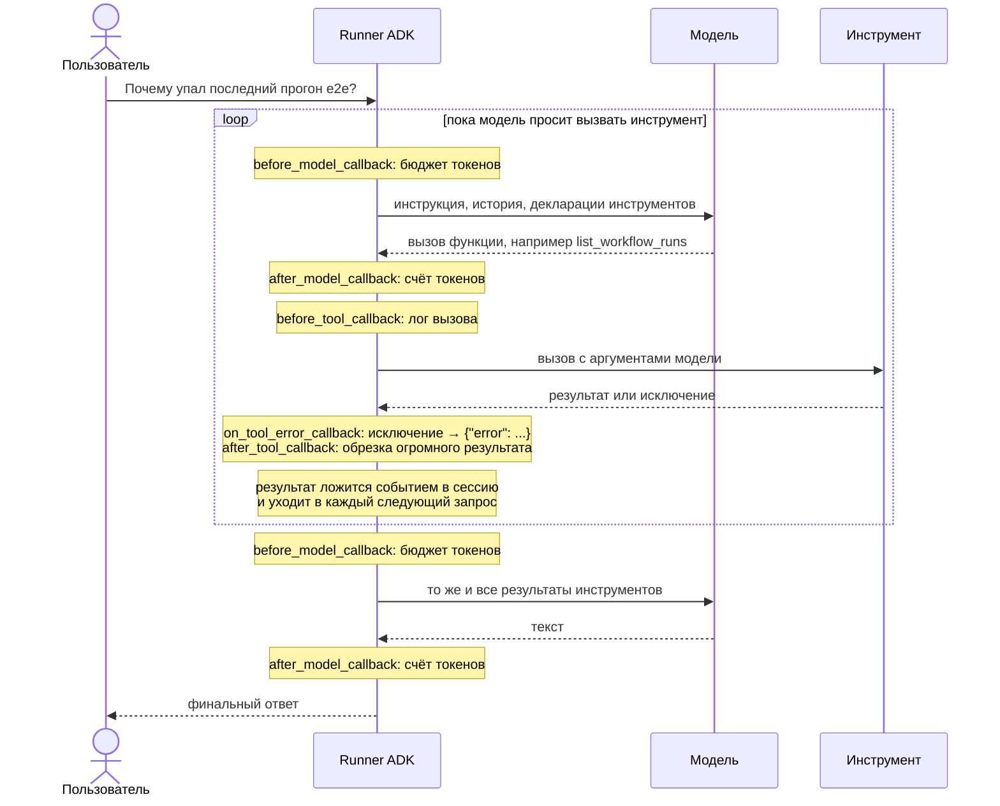
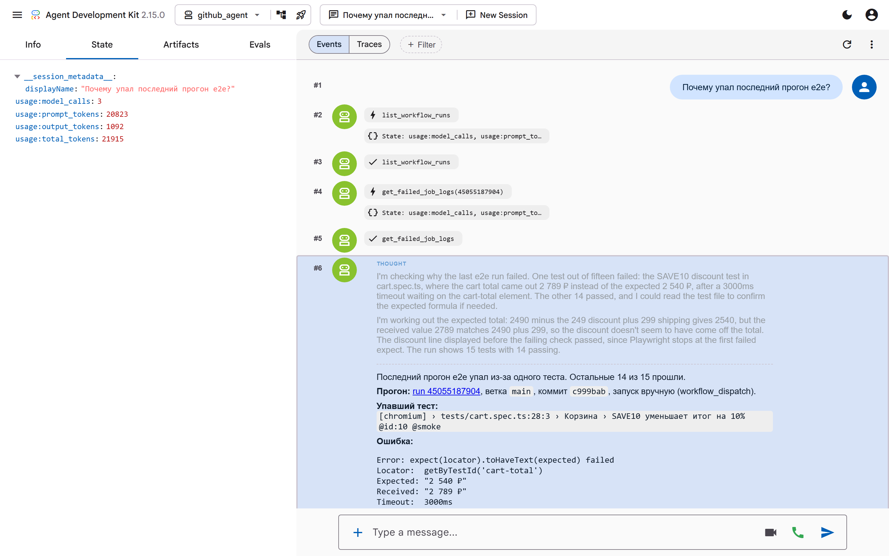
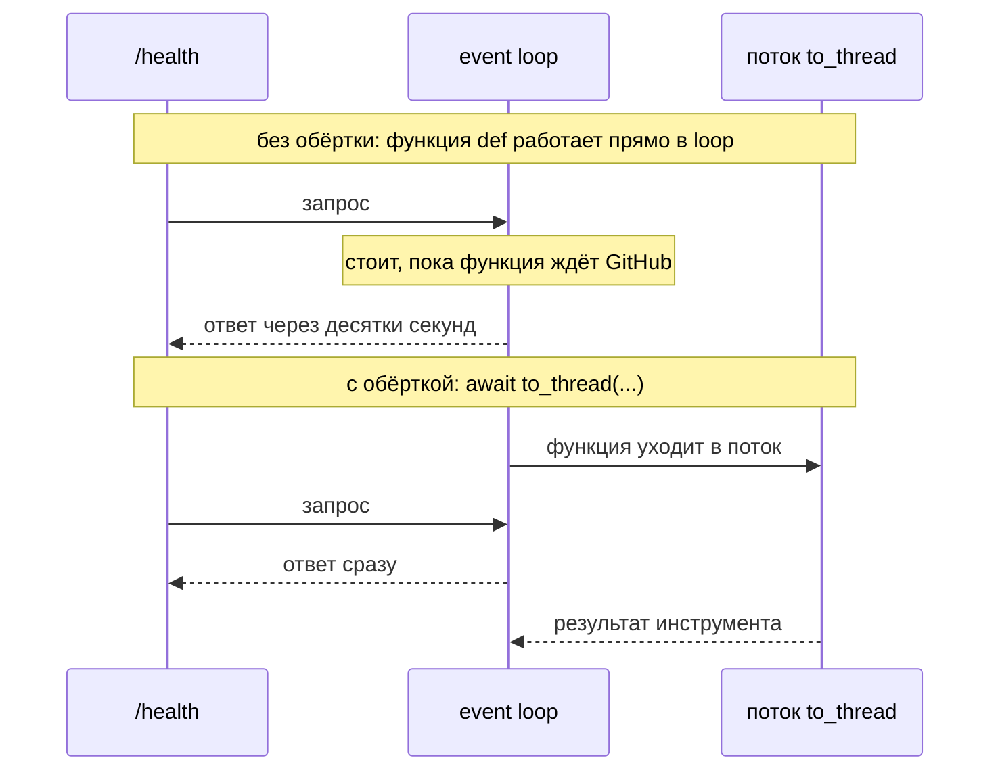

# Урок 1. Основы ADK: первый агент, который не стыдно запустить

Время чтения: 45 минут. Задание к уроку: [README.md](README.md).

К концу урока вы будете понимать:

- как устроен Google ADK, как запустить агента у себя и где смотреть, что он делает, и что из курса переносится на ADK для Java, TypeScript и Go;
- из чего состоит агент и как модель «видит» ваши функции;
- что происходит между вопросом пользователя и ответом агента;
- почему вызов модели иногда падает, какие ошибки стоит повторять и почему таймаут по умолчанию слишком велик;
- какие колбэки нужны агенту с первого дня и почему;
- почему одна медленная функция может перезапустить контейнер со всеми пользователями.

## Что мы строим

За девять модулей вы соберёте ассистента QA-инженера. Он разбирает падения CI, заводит баги, пишет и чинит автотесты, сортирует обращения поддержки и работает в продакшене с входом через GitHub, не вынося данные компании наружу. Работает он с учебным магазином Shoplite, который можно ломать флагами: переименовать `data-test`, сломать расчёт скидки, положить базу.

В первом модуле агент один: `github_agent`. Он отвечает на вопросы о прогонах GitHub Actions вашего форка и читает файлы репозитория. Задача скромная, но вокруг неё строится всё, без чего агента нельзя отдавать людям: настройка модели, повторы, логи, счёт токенов, защита от огромных ответов и от зависания.

## Что такое ADK

Agent Development Kit (ADK) от Google помогает писать агентов на Python. Ставится он пакетом `google-adk`, который уже есть в `pyproject.toml` курса, и даёт три вещи:

- **Классы, которыми описывают агента.** `Agent` с моделью, инструкцией и списком функций-инструментов. Эту часть пишете вы.
- **Исполнитель `Runner`.** Он ведёт разговор: зовёт модель, вызывает инструменты, которые она попросила, хранит историю. Этот код уже написан, вы его только настраиваете.
- **Веб-сервер с интерфейсом разработчика.** Команда `adk web` открывает в браузере чат с вашими агентами и показывает каждый их шаг.

ADK не привязан к моделям Google. В курсе агенты работают с Claude через API Anthropic.

### Как части связаны



Отдельного фронтенда запускать не нужно. `adk web` поднимает один процесс на Python: веб-сервер FastAPI. Он отвечает на запросы API и отдаёт браузеру готовый интерфейс, который лежит внутри пакета `google-adk`. Node.js и сборка фронтенда для этого не нужны.

Когда вы пишете вопрос в чат, браузер отправляет его серверу, сервер передаёт его `Runner`, а тот ходит в Claude и, через ваши инструменты, в GitHub. Каждый шаг сервер сразу отправляет браузеру, поэтому вызовы инструментов появляются на экране раньше ответа.

Сессия хранит один разговор: историю событий и state. State сессии устроен как словарь «ключ → значение», который живёт вместе с разговором между ходами. Записывают в него ADK и ваш код. Наш агент, например, будет складывать туда счёт токенов под ключами вроде `usage:total_tokens`.

Сессии `adk web` хранит в SQLite в папке агента: `assistant/agents/github_agent/.adk/session.db`. Поэтому разговоры переживают перезапуск сервера. Папка `.adk/` есть в `.gitignore`.

Агентов сервер находит сам. Каждая папка внутри `assistant/agents/` для него отдельное приложение, если в ней есть `agent.py` с переменной `root_agent`. Имя папки становится именем агента в интерфейсе.

### Как запустить у себя

Сначала подготовьте окружение по README курса, раздел «Подготовка»: виртуальное окружение, `pip install -e ".[dev]" -c constraints.txt` и `.env` с `ANTHROPIC_API_KEY`, `GITHUB_REPO` и `GITHUB_TOKEN`. Команда `python scripts/doctor.py` проверит всё это и не потратит ни одного токена.

Дальше одна команда из корня репозитория, в активированном виртуальном окружении:

```bash
adk web --port 8080 assistant/agents
```

- `assistant/agents` указывает на папку со всеми агентами. `github_agent` ADK найдёт в ней сам.
- `--port 8080` оставляет свободным порт 8000. ADK по умолчанию занимает его, а в модулях 3–9 на нём работает стенд магазина.
- `.env` из корня репозитория `adk web` читает сам.

Когда в терминале появится строка `For local testing, access at http://127.0.0.1:8080`, откройте в браузере http://localhost:8080. Адрес перенаправит на `/dev-ui/`.

Терминал остаётся занят сервером, и в нём же идут логи: вызовы инструментов, предупреждения ADK, трейсбеки. Если в браузере что-то пошло не так, смотрите сюда. Остановить сервер можно клавишами Ctrl+C. Поменяли код агента? Перезапустите `adk web`, так вы точно говорите с новой версией.

Агент запускается и до заданий, но из его инструментов работает только готовый `list_workflow_runs`. Два других пока бросают `NotImplementedError`, поэтому вопрос про причину падения закончится ошибкой с трейсбеком в терминале. Так и должно быть: эти инструменты вы напишете в задании 2.

Второй способ запуска понадобится в домашнем задании:

```bash
uvicorn --env-file .env assistant.app:app --port 8080
```

Он запускает то же самое из файла `assistant/app.py`. ADK собирает там приложение функцией `get_fast_api_app`, а мы можем добавлять к нему свои адреса: в модуле 5 там появится вебхук. Адрес `/health`, ответ на проверку «процесс жив», ADK добавляет сам, он есть при обоих способах запуска. В `assistant/app.py` объявлен и свой `/health` с тем же ответом: ADK 2.15 регистрирует свой адрес раньше, поэтому отвечает он, а наш остаётся запасным. Домашнее задание запускает именно `assistant/app.py`, потому что это приложение потом работает у команды: в модуле 8 его же запускает контейнер.

Запись `assistant.app:app` значит: модуль `assistant.app`, то есть файл `assistant/app.py`, и в нём переменная `app`. `--env-file .env` просит uvicorn прочитать `.env` перед запуском. Команда одинаковая для bash и PowerShell.

Сервер готов, когда в терминале появилась строка `Uvicorn running on http://127.0.0.1:8080 (Press CTRL+C to quit)`. Проверить его можно из второго терминала: `curl http://localhost:8080/health` в bash или `Invoke-RestMethod http://localhost:8080/health` в PowerShell возвращают `{"status":"ok"}` (PowerShell показывает этот ответ таблицей). Интерфейс в этом случае открывается по адресу http://localhost:8080/dev-ui/. Останавливается сервер так же, Ctrl+C.

### Где смотреть: экран dev UI


*Разговор с `github_agent`: вопрос «Почему упал последний прогон e2e?», вызовы инструментов и ответ модели.*

- **Вверху слева** выбор агента. В модуле 1 он один, `github_agent`; со следующими модулями их станет больше.
- **Вверху посередине** текущая сессия и кнопка New Session. Сессия хранит один разговор: историю и state. Вопрос без старого контекста задавайте в новой сессии. Прошлые сессии открываются из выпадающего списка.
- **Справа** чат. Внизу поле ввода, над ним лента событий (вкладка Events): ваш вопрос, вызов инструмента (значок молнии), его результат (галочка), ответ модели. Вкладка Traces рядом показывает те же шаги со временем выполнения.
- **Слева** подробности. Клик по событию открывает его на вкладке Info: запрос и ответ модели, аргументы и результат инструмента. Ниже нарисован граф: агент и его инструменты. Вкладка State показывает state сессии, туда наш агент будет записывать счёт токенов. Artifacts и Evals в этом модуле не нужны.

### ADK на других языках

Курс написан на Python, но ADK есть и для Java, Kotlin, TypeScript и Go. Устроены они одинаково: агент с моделью, инструкцией и инструментами, колбэки, сессии, сабагенты, MCP. Если вы пишете автотесты на Java или TypeScript, главное из курса переносится на ваш язык почти без изменений: роли агентов и их описания, инструменты с понятной для модели декларацией, проверки в коде вместо просьб в промпте, eval и границы доверия.

Переносится не всё. Часть подвохов курса питоновские: блокировка event loop в этом уроке, `functools.wraps`, декораторы. Набор возможностей у языков разный, и новое появляется в них не одновременно. Прежде чем строить на чём-то из ADK 2.x (графы, плагины, кэш промпта), проверьте, есть ли это в документации вашего языка на [adk.dev](https://adk.dev/).

Для этого курса важно, как язык ходит к Claude. Так это описано на странице [Claude в ADK](https://adk.dev/agents/models/anthropic/):

| Язык | По ключу Anthropic, как в курсе | Через Google Cloud |
|---|---|---|
| Python | да, класс `AnthropicLlm`; `CourseClaude` из курса его наследник | да |
| Java, Kotlin | да | да |
| Go | да, но пакет пока экспериментальный и для продакшена не рекомендован | да |
| TypeScript | нет | да, только так |

Агентов на разных языках можно собрать в одну систему. Для этого есть протокол A2A (Agent2Agent): каждый агент работает отдельным сервисом, а другие вызывают его по сети и не знают, на чём он написан. В уроках курса A2A не разбирается. После модуля 9 есть задание по желанию: перенести `testcases_agent` на Java и позвать его из `root` по A2A (`modules/a2a/README.md`).

## Коротко о языковой модели

Агент держится на языковой модели (LLM), в курсе это Claude. Для вашего кода модель выглядит как HTTP API с простым контрактом.

- **На вход текст, на выход текст.** В запросе инструкция, история разговора и новое сообщение. В ответе текст для пользователя.
- **Или просьба вызвать функцию.** Если в запросе описаны функции, модель может вместо текста вернуть «вызови `list_workflow_runs` с `status="failure"`». Сама она ничего не вызывает и в сеть не ходит. Функцию вызывает ваш код (в ADK это делает `Runner`) и следующим запросом отправляет модели результат.
- **Модель ничего не помнит между вызовами.** Каждый вызов начинается с чистого листа. Поэтому каждый запрос заново несёт инструкцию, описания функций и всю историю разговора вместе с результатами функций.
- **Всё считается в токенах.** Токеном называют кусок текста: слово, часть слова или знак препинания. В токенах меряют размер запроса и ответа, и за них же платят. Вход и выход стоят по-разному: у Claude Haiku 5.5 миллион входных токенов стоит $0,10, а выходных $0,50 ([docs/models.md](../../docs/models.md)).
- **Окно контекста ограничено.** Так называют предел, сколько токенов модель обработает за один вызов. Запрос, который в него не помещается, модель не примет.

Из последних трёх пунктов следует почти всё в этом уроке. История растёт с каждым шагом и уходит в каждый вызов, поэтому агенту нужны счёт токенов, бюджет на сессию, обрезка огромных ответов инструментов и кэш промпта.

## Из чего состоит агент

Если вы писали обёртки над API моделей, вы привыкли к циклу: отправить запрос, разобрать ответ, вызвать функцию, если модель её попросила, отправить результат, повторить. В ADK этот цикл уже написан, его исполняет `Runner`. Ваша часть: описать агента.

```python
from google.adk.agents import Agent

root_agent = Agent(
    name="github_agent",
    model=get_llm("github_agent"),
    description="Прогоны GitHub Actions и файлы репозитория: ...",
    instruction=INSTRUCTION,
    tools=[list_workflow_runs, get_failed_job_logs, read_repo_file],
)
```

У каждого поля свой читатель.

| Поле | Кто читает | Для чего |
|---|---|---|
| `name` | ADK, другие агенты | идентификатор; по нему агенту передают задачу |
| `model` | ADK | какую модель вызывать и с какими настройками |
| `description` | **другой агент** | решение, отдать ли этому агенту запрос (модуль 2) |
| `instruction` | модель | системная инструкция на каждый вызов |
| `tools` | модель и ADK | что агент умеет делать |

Самая частая ошибка новичков: писать `description` как комментарий для программиста («агент для GitHub»). Читает его модель-оркестратор (агент, который раздаёт запросы остальным, модуль 2), когда решает, кому передать запрос. В модуле 2 у нас будет пять агентов, и с плохим `description` вопрос про упавший прогон уйдёт агенту тест-кейсов. Поэтому уже сейчас описание перечисляет, **с какими запросами** идти к агенту: «последние запуски e2e, почему упал прогон, логи упавших джоб, содержимое тестов».

### Как модель видит вашу функцию

Инструментом в ADK служит обычная функция Python. Её код модель не видит. Она видит **декларацию**: имя, описание и параметры, которые ADK строит из сигнатуры, аннотаций типов и docstring.

```python
def list_workflow_runs(workflow: str = "e2e.yml", branch: str = "", status: str = "",
                       limit: int = 10) -> dict[str, Any]:
    """Lists recent GitHub Actions runs of the repository, newest first.

    Args:
        workflow: Workflow file name, e.g. "e2e.yml". Empty string means all workflows.
        branch: Only runs on this branch. Empty string means any branch.
        status: "failure", "success", "in_progress", "completed" or empty for any.
        limit: How many runs to return, 1..30.
    """
```

Об этом инструменте модель знает только текст выше. Отсюда три правила, которые сэкономят вам часы отладки:

1. **Docstring пишется для модели.** «Returns runs» бесполезно. «Пустая строка означает все workflow», «1..30» полезно: модель не станет передавать `limit=1000`.
2. **Типы обязательны.** Без аннотаций модель не знает, число `limit` или строка.
3. **Результат должен быть коротким словарём с понятными полями.** Весь JSON ответа GitHub отдавать не нужно: в нём сотни полей, и каждое уходит в контекст модели и стоит токенов. `list_workflow_runs` возвращает десять полей на прогон.

И ещё одно правило, о котором забывают: **ожидаемая ошибка тоже результат**. Если нет переменной окружения, GitHub ответил 404 или у токена нет прав, инструмент возвращает `{"error": "Не найдено: ... Проверь GITHUB_REPO и права токена."}`. Модель прочитает это и объяснит пользователю, что поправить. Исключение на этом месте оставит модели в лучшем случае тип и текст ошибки, без подсказки, что поправить. Как ADK обходится с исключениями инструментов, разобрано в разделе про колбэки.

## Что происходит, когда пользователь задаёт вопрос

Пользователь в `adk web` пишет «Почему упал последний прогон e2e?». Дальше:

1. **Runner** берёт сессию пользователя (историю разговора) и собирает запрос к модели: инструкция, история, декларации инструментов, новое сообщение. Как `Runner` создают в коде, видно в `run_agent` из `tests/helpers/runner.py`.
2. Модель отвечает **вызовом функции**: `list_workflow_runs(status="failure", limit=1)`. Текста для пользователя в этом ответе нет.
3. ADK вызывает вашу функцию, кладёт результат в сессию как событие и снова зовёт модель, уже с результатом.
4. Модель просит `get_failed_job_logs(run_id=1002)`. Снова вызов, снова модель.
5. Модель отвечает текстом. Это финальный ответ, цикл закончен.

Каждый шаг ADK записывает в сессию как **событие** (`Event`). На скриншоте выше это строки #1–#6 в ленте справа: #1 ваш вопрос, #2–#5 вызовы инструментов и их результаты, #6 ответ модели. Лента событий станет вашим главным инструментом отладки. Когда агент ответил ерунду, по событиям видно, какой инструмент он вызвал, с какими аргументами и что получил. По одному ответу причину не найти.

Плашка `State` у события значит, что оно изменило state сессии, словарь из раздела «Что такое ADK».

Серый текст с пометкой `THOUGHT` в событии #6 показывает размышления модели. Claude может перед ответом рассуждать про себя, а `CourseClaude` (о нём ниже) включает это в адаптивном режиме: модель сама решает, нужно ли думать и сколько. В событии размышления лежат отдельной частью с `thought=True`, в текст ответа они не входят. Оплачиваются они как выход, поэтому в задании 3 их токены (`thoughts_token_count`) входят в счёт.

<details>
<summary>Запись вживую: вопрос, события, вкладка State (24 с)</summary>


</details>

Обратите внимание на шаг 3: результат инструмента остаётся в сессии и уходит в **каждый следующий** вызов модели. Это важно для раздела про обрезку ответов.

## Модель: настройка и повторы

### Какую модель возьмёт агент

Агент получает модель из `get_llm("github_agent")`. Имя модели для неё находит функция `model_name`. Она ищет в трёх местах по очереди и берёт первое найденное:

1. Переменная `AGENT_MODEL_GITHUB_AGENT`: модель только для этого агента. Имя агента в ней пишется заглавными.
2. Переменная `AGENT_MODEL`: модель для всех агентов, у которых нет своей переменной. В `.env.example` это `claude-haiku-5-5`.
3. Константа `DEFAULT_MODEL` в `config.py`, если не задана ни одна из переменных.

Зачем так сложно? К концу курса агентов будет семь, и задачи у них разные. На вопросы о прогонах хорошо отвечает быстрая дешёвая модель, а агенту, который пишет автотесты (`playwright_agent`, модуль 4), может понадобиться сильная. Две строки в `.env` переводят на Sonnet его одного, код при этом не меняется:

```text
AGENT_MODEL=claude-haiku-5-5
AGENT_MODEL_PLAYWRIGHT_AGENT=claude-sonnet-5-5
```

Этот порядок поиска вы напишете в задании 1, в функции `model_name`.

### Почему модель не строкой

ADK принимает и строку: `Agent(model="claude-haiku-5-5")`. Но по такой строке он создаст свой класс `Claude`, который ходит к Claude через Google Cloud, и без проекта в Google Cloud агент упадёт на первом вопросе. Курс работает с API Anthropic напрямую, по ключу `ANTHROPIC_API_KEY`. Для этого в `config.py` уже есть класс `CourseClaude`, и модель для агента всегда создаёт `get_llm`. Править `CourseClaude` не нужно. Кроме подключения к API, он включает адаптивные размышления (тот самый `THOUGHT`) и кэш промпта, о котором ниже.

### Повторы и таймаут

Агент обращается к Claude по сети, на серверы Anthropic, и по дороге случается разное:

- **Перегрузка у Anthropic.** Когда серверам не хватает мощности, API отвечает `529 overloaded_error` или `500`. Через несколько секунд тот же запрос обычно проходит.
- **Ваш лимит.** У каждого аккаунта есть лимиты запросов и токенов в минуту. Разговор из четырёх вопросов в этом модуле расходует около 150 тысяч токенов, поэтому несколько быстрых вопросов подряд могут упереться в лимит. Тогда API отвечает `429`. Насколько быстро это случится, зависит от уровня вашего аккаунта: лимиты уровней показаны в консоли Claude.
- **Сеть.** Пропавший Wi-Fi, VPN или корпоративный прокси обрывают соединение посреди запроса.
- **Зависание.** Соединение живо, а ответа нет. По умолчанию клиент ждёт его до 10 минут.

Без повтора любой такой сбой превращается для пользователя в ответ «что-то пошло не так», хотя через секунду тот же запрос прошёл бы.

Повторы живут в клиенте Anthropic SDK, а `CourseClaude` передаёт ему два своих поля. В заготовке у них значения SDK по умолчанию (комментарии в листинге переведены и дополнены):

```python
class CourseClaude(AnthropicLlm):
    max_retries: int = 2      # первая попытка и два повтора, паузы растут экспоненциально
    timeout: float = 600.0    # секунд на один вызов: 10 минут
```

Дальше легко спутать имя модели и объект модели. Имя задаётся строкой вроде `"claude-haiku-5-5"`, его находит `model_name`. Объект попадает в `Agent(model=...)`: он ходит в API, и в нём живут `max_retries` и `timeout`. Задаются они один раз, при создании объекта.

Объект создаёт функция `build_llm(model, **client)` из того же `config.py`. Первым аргументом `model` она получает имя. По нему она выбирает провайдера (Claude, Gemini или сервер с API OpenAI) и класс объекта. Запись `**client` в Python значит «все остальные именованные аргументы»: что бы вы ни передали после имени, например `max_retries=...` и `timeout=...`, функция без изменений передаст это конструктору объекта. Сам `get_llm` объект не собирает, он отдаёт эту работу `build_llm`. Какие значения выбрать, решаете вы в задании 1.

Что повторять, SDK решает сам, и решение стоит понять:

- **408, 409, любой 5xx (в том числе 529), обрыв соединения.** Временные сбои: через секунду-две запрос, скорее всего, пройдёт. Повторять.
- **429.** Превышен лимит запросов или токенов в минуту. У Anthropic лимиты пополняются непрерывно, а в ответе есть заголовок `retry-after`: через сколько секунд можно снова. SDK ждёт ровно столько. Повторять.
- **400, 401, 403, 404.** Ошибка в запросе, ключе или имени модели. Повтор вернёт то же самое. Не повторять.

Правило за этим списком: повторять стоит то, что пройдёт само за время ожидания. Что именно значит код, зависит от провайдера. У бесплатного уровня Gemini 429 означает исчерпанную суточную квоту: за секунды она не восстановится, и повтор только сожжёт остаток. Прежде чем настраивать повторы, прочитайте, что ваш провайдер имеет в виду под 429.

`max_retries` ограничивает число повторов, а `timeout` ограничивает каждое ожидание. Если не задать `timeout`, один зависший вызов держит пользователя до десяти минут, а с двумя повторами по умолчанию до получаса. 429, который не прошёл и после повторов, в модуле 8 мы превратим в понятное сообщение «модель перегружена».

Как выбрать значения:

- **Паузы между повторами SDK считает сам.** 0,5 с перед первым повтором, дальше каждая вдвое длиннее, но не больше 8 с, и каждую он случайно укорачивает на величину до 25%. Если в ответе есть `retry-after`, SDK ждёт столько, сколько там сказано. Так что сами паузы стоят пользователю секунды.
- **Минуты ожидания набегают из-за `timeout`.** В худшем случае, когда зависает каждая попытка, ожидание складывается из `max_retries + 1` таймаутов и пауз между ними. Со значениями по умолчанию это 3 × 600 с, то есть 30 минут.
- **Таймаут берите из замера.** Сколько на самом деле длится вызов модели у вас, видно во вкладке Traces в `adk web`: у каждого шага `call_llm` указано время. Таймаут ставьте с запасом над самым долгим нормальным вызовом, который вы там видели. Тогда он обрывает только зависший вызов.

Ещё одна деталь, которая выглядит мелочью: повторяется **только вызов модели**. Инструменты этот механизм не перезапускает. Когда в модуле 2 появится инструмент «завести задачу», повтор на уровне инструмента означал бы две одинаковые задачи в трекере.

### Кэш промпта

Как сказано в разделе «Коротко о языковой модели», каждый вызов заново отправляет инструкцию агента, описания инструментов и весь разговор. Почти всё в очередном запросе уже отправлялось в предыдущем.

Anthropic умеет кэшировать начало промпта: повторное начало он читает из кэша по 0,1 цены входа. В курсе кэш уже включён в `CourseClaude` для каждого запроса, делать ничего не нужно. Сколько это даёт, видно на живой проверке этого модуля: разговор из 4 вопросов с `github_agent` расходует около 150 тысяч токенов и стоит на Haiku $0,006 с кэшем, а без кэша стоил бы $0,016. Больше всего в нём весит лог упавшего прогона.

<details>
<summary>Подробнее: как включён кэш, замеры и почему нет сжатия истории</summary>

Запись в кэш стоит 1,25 цены входа. В ADK кэш включается конфигурацией `ContextCacheConfig`, и `CourseClaude` добавляет её к каждому запросу:

```python
PROMPT_CACHE = ContextCacheConfig(min_tokens=1024, ttl_seconds=300, cache_intervals=100)
```

Здесь два разных порога, их легко спутать. У Anthropic минимальный кэшируемый префикс для Claude Haiku 5.5 равен 512 токенам: короче API не кэширует. `min_tokens=1024` относится к самому ADK: он размечает кэш, только если предыдущий запрос сессии был не короче 1024 токенов, а на первом запросе размечает всегда. Промпт наших агентов больше обоих порогов: у `github_agent` на «Привет» в запросе 1 732 токена, это 3,4 порога Anthropic и 1,7 порога ADK.

Обычно конфигурацию задают на уровне приложения: `App(context_cache_config=...)`. Но `adk web` собирает своё приложение для каждой папки агента, а конвейеры модулей 5–6 запускают свои `Runner`. Поэтому настройку добавляет сама модель: так кэш есть у любого агента, где бы его ни запустили. Своя настройка у приложения, если она есть, остаётся главной.

Что запрос ушёл с кэшем, видно по полю `cached_content_token_count` в `usage_metadata` ответа: столько токенов входа прочитано из кэша.

Замеры на сессиях следующих модулей, Haiku, по три прогона:

| Сессия | Без кэша | С кэшем |
|---|---|---|
| разговор с `root` из 5 вопросов (модуль 2) | $0,025 | $0,012 |
| починка теста `healing_agent` (модуль 4) | $0,033, разброс $0,001–0,075 | $0,010 |

Разговор с `root` подешевел вдвое: в нём 18 вызовов модели, и из 240 тысяч токенов входа 170 тысяч прочитаны из кэша. У `healing_agent` разброс между прогонами больше, чем разница от кэша: иногда агент чинит тест за десяток шагов, иногда сразу останавливается и задаёт вопрос. Так что точные цифры по нему не стоит воспринимать всерьёз.

`ttl_seconds=300` значит, что кэш живёт 5 минут с последнего использования. Если между вопросами в `adk web` проходит больше пяти минут, следующий вызов запишет кэш заново. Часовой кэш (`ttl_seconds` от 3600) стоит при записи вдвое дороже обычного входа. Для разговора с паузами он может окупиться, для конвейера, который делает вызовы подряд, нет.

**Почему мы не включили сжатие истории.** В ADK 2.x есть второй способ укоротить промпт: сжатие истории (`EventsCompactionConfig`). Старые события разговора заменяются сводкой, которую пишет модель. Мы замерили и его, с порогом в 30 тысяч токенов:

| Сессия | Только кэш | Кэш и сжатие |
|---|---|---|
| разговор с `root` | $0,012 | $0,009 |
| починка теста | $0,010, 11 вызовов | $0,023, 19 вызовов |

На разговоре сжатие немного помогло. На починке теста стало вдвое дороже. Сводка **переписывает начало истории**, а кэш держится на неизменном начале: после каждого сжатия кэш записывается заново, плюс вызовы модели на саму сводку. Два механизма экономии мешают друг другу.

Поэтому сжатие в курсе выключено. Его стоит включать, когда разговор упирается в контекстное окно модели. И общий урок: оптимизацию цены проверяйте замером на своих сессиях. По описанию не угадать, как два механизма поведут себя вместе.

</details>

## Колбэки: что агенту нужно с первого дня

Колбэком называют функцию, которую ADK вызывает в определённый момент цикла. Нам нужны пять:

| Колбэк | Функция в `observability.py` | Когда | Что делаем |
|---|---|---|---|
| `before_tool_callback` | `log_tool_call` | перед вызовом инструмента | пишем в лог, кто и с какими аргументами |
| `after_tool_callback` | `truncate_tool_response` | после вызова | обрезаем огромный результат |
| `on_tool_error_callback` | `tool_error_to_result` | инструмент бросил исключение | превращаем в `{"error": ...}` |
| `before_model_callback` | `enforce_token_budget` | перед вызовом модели | проверяем бюджет токенов сессии |
| `after_model_callback` | `count_tokens` | после ответа модели | считаем токены |

Ошибки инструмента ловятся в двух местах. Ожидаемые сбои инструмент возвращает сам, с подсказкой, что поправить: в заготовке это делает декоратор `_errors_as_result` в `tools.py` агента. `on_tool_error_callback` страхует от неожиданных исключений: модель получит тип и текст ошибки и сможет рассказать о ней пользователю. Пока колбэк не написан, такое исключение обрывает ход трейсбеком в терминале.

Вот где они срабатывают в цикле из раздела «Что происходит, когда пользователь задаёт вопрос»:



У всех колбэков ADK одно соглашение, и его стоит запомнить: **`None` значит «продолжай как обычно», значение значит «используй вместо»**. Если `after_tool_callback` вернул словарь, модель получит его вместо настоящего результата. Если `before_model_callback` вернул `LlmResponse`, модель вообще не вызывается, и пользователь получает этот ответ.

Колбэки собраны в словарь `AGENT_CALLBACKS` и подключаются к каждому агенту одной строкой `**AGENT_CALLBACKS`. Две звёздочки перед словарём в вызове разворачивают его в именованные аргументы: пара с ключом `before_tool_callback` приходит в `Agent` как параметр `before_tool_callback=log_tool_call`. Когда агентов станет пять, вы будете рады, что не подключали их по одному: в модуле 2 тест проверит, что ни один агент колбэки не потерял.

### Что колбэк получает

Сигнатуры всех пяти функций уже есть в заготовке `assistant/shared/observability.py`. ADK передаёт аргументы по имени, поэтому имена параметров не меняйте.

- **State сессии.** У колбэков модели он лежит в `callback_context.state`, у колбэков инструмента в `tool_context.state`. Работают они одинаково: в ADK 2.x `ToolContext` и `CallbackContext` называют один и тот же класс. Ведёт себя state как словарь: `state.get(ключ, 0)` читает значение с запасным вариантом, `state[ключ] = значение` записывает. ADK сам сохранит запись в сессии и покажет её во вкладке State. Имена ключей (`usage:total_tokens` и другие) заданы константами в начале файла.
- **Кто вызвал.** Имя агента лежит в `callback_context.agent_name` и `tool_context.agent_name`, имя инструмента в `tool.name`, аргументы вызова в словаре `args`.
- **Расход токенов.** У ответа модели есть поле `llm_response.usage_metadata` типа `types.GenerateContentResponseUsageMetadata`. Его поля:

  | Поле | Что в нём |
  |---|---|
  | `prompt_token_count` | весь вход вызова, включая прочитанное из кэша |
  | `candidates_token_count` | текст ответа и вызовы функций |
  | `thoughts_token_count` | размышления; `None`, если модель не думала |
  | `total_token_count` | вход и весь выход вместе |
  | `cached_content_token_count` | часть входа, прочитанная из кэша |

- **Ответ вместо модели.** Чтобы `before_model_callback` ответил сам, верните `LlmResponse` (класс уже импортирован в заготовке). Текст ответа кладётся в его поле `content`: это `types.Content` с ролью `"model"` и списком `parts` из одного `types.Part` с текстом. Так же собрано сообщение пользователя в `tests/helpers/runner.py`, только с ролью `"user"`.

### Где виден лог

`log_tool_call` пишет в логгер `log`, он уже создан в начале файла как `logging.getLogger("assistant")`. `adk web` при запуске настраивает логирование на уровень INFO, поэтому строки `log.info(...)` появляются в том же терминале, где работает сервер. Выглядят они так: время, `INFO`, файл и строка, потом ваше сообщение. Под `uvicorn` из домашнего задания строки уровня INFO не видны: там логирование никто не настраивает, и выводятся только предупреждения и ошибки.

### Обрезка ответов: история про скриншот

В проекте, на котором основан курс, один инструмент вернул скриншот страницы в base64: 2,2 МБ текста, примерно 570 тысяч токенов. Вспомните шаг 3 из раздела выше: результат инструмента уходит в каждый следующий вызов модели. Один такой ответ съедал бюджет и упирался в окно контекста, и сессия ломалась.

Защищает от этого `after_tool_callback`: если результат длиннее лимита `MAX_TOOL_RESPONSE_CHARS` (по умолчанию 20 000 символов, см. `.env.example`), модель получает вместо него начало и пометку «ответ обрезан до N из M символов, запроси меньший фрагмент». Пометка важна: без неё модель будет рассуждать о начале лога так, будто это весь лог. С ней она знает, что видит не всё, и может попросить меньше.

Здесь вы впервые встречаете идею, которая пройдёт через весь курс: **модель должна знать, что ответ неполный**. В модуле 5 она вернётся: если какой-то источник данных о падении не собрался, разбор прямо говорит об этом модели.

### Бюджет токенов

У агента в цикле нет явного условия выхода: модель вызывает инструмент, получает ошибку, вызывает снова. `after_model_callback` складывает `usage_metadata` ответа в state сессии, а `before_model_callback` перед каждым вызовом сверяет сумму с `SESSION_TOKEN_BUDGET` (по умолчанию 1 500 000 токенов). Если бюджет превышен, модель не вызывается, и пользователь получает «Лимит токенов исчерпан, начните новую сессию». Тест ищет в ответе слова «Лимит токенов». Зациклившийся агент остановится на этом лимите и не опустошит ваш баланс.

Ключи state вроде `usage:total_tokens` видно во вкладке State в `adk web`: так вы узнаете реальную цену разговора.



*Тот же разговор: три вызова модели, 21 915 токенов. Почти всё приходится на вход: инструкция, инструменты и результаты инструментов уходят в каждый вызов заново.*

## Главная история урока: медленная функция убивает контейнер

Эту часть стоит прочитать внимательно: ошибка неочевидная и часто встречается в проектах на асинхронных фреймворках.

### Что случилось

Инструмент ходил во внешнюю систему тест-кейсов и листал её постранично. На большом проекте это занимало около 30 секунд. В Kubernetes у контейнера была liveness-проба, то есть регулярная проверка «процесс жив»: раз в несколько секунд запрос на `/health` с таймаутом 1 секунда. Пока инструмент работал, `/health` не отвечал. После трёх неответов подряд Kubernetes решил, что контейнер завис, и перезапустил его. Вместе с разговорами всех пользователей, которые в этот момент работали с ассистентом.

### Почему так

ADK написан на asyncio, как и FastAPI под ним. Если вы пришли из Java, полезная аналогия такая. В классическом сервере на потоках каждый запрос получает свой поток, и медленный запрос занимает только его. В asyncio поток **один**, его называют event loop. Он переключается между задачами, но только в точках `await`: «пока жду сеть, займусь другим».

Обычная функция `def`, которая делает блокирующий HTTP-запрос (`httpx.get`, `requests.get`), точек `await` не имеет. Пока она ждёт ответа, event loop стоит. Не обрабатываются ни другие пользователи, ни `/health`. А инструменты-функции `def` ADK вызывает **прямо в event loop**.

Почему не написать все инструменты асинхронными? Можно, и для новых это хороший выбор. Но синхронный код живёт и в существующих клиентах, SDK и библиотеках, которые вы не будете переписывать. Нужен способ запускать их, не останавливая loop.

### Решение

`asyncio.to_thread(func, *args)` запускает функцию в отдельном потоке и возвращает то, чего можно дождаться через `await`. Loop свободен, пока функция работает. Обёртка над синхронным инструментом получается асинхронной функцией, которая ждёт `to_thread`.

Обёрткой (wrapper) называют функцию, которая вызывает другую и добавляет что-то до или после вызова. Функцию, которая принимает функцию и возвращает такую обёртку, называют декоратором. Готовый образец есть в заготовке: `_errors_as_result` в `assistant/agents/github_agent/tools.py` оборачивает инструменты GitHub и превращает ожидаемые исключения в `{"error": ...}`. Запись `@_errors_as_result` над `def list_workflow_runs` значит то же, что `list_workflow_runs = _errors_as_result(list_workflow_runs)`. Обратите внимание на `@functools.wraps(func)` внутри: зачем он, объяснено ниже.

В домашнем задании такое оборачивание делает функция `offload_blocking_tools` в `assistant/shared/tools.py`. Агент передаёт ей свой список инструментов (`agent.py`, параметр `tools`). В списке бывают вперемешку обычные функции `def`, функции `async def` и объекты-инструменты, которые появятся в следующих модулях. Возвращает она список тех же инструментов: синхронные функции обёрнуты, async-функции и объекты остаются как были.

Вот как выглядит запрос `/health`, который пришёл, пока инструмент ждёт GitHub, без обёртки и с ней:



Подвох в том, что ADK строит декларацию инструмента из сигнатуры и docstring. Обёртка вида `async def wrapper(*args, **kwargs)` превратит `list_workflow_runs(workflow, branch, status, limit)` в инструмент без описания и с непонятными параметрами. Модель перестанет им пользоваться правильно. `functools.wraps` копирует имя, docstring, аннотации и ставит `__wrapped__`, по которому `inspect.signature` находит исходную сигнатуру. Тест домашнего задания сравнивает декларации до и после обёртки: они должны совпасть.

### А как же встроенное решение?

`RunConfig` (класс `google.adk.agents.RunConfig`) хранит настройки одного запуска `Runner`. В ADK 2.x в нём появилось поле `tool_thread_pool_config`: с ним синхронные инструменты уходят в пул потоков сами. Хорошая новость, но прежде чем на неё положиться, выясните, кто создаёт `RunConfig`, когда запрос приходит через `get_fast_api_app`. Через него работают и `adk web`, и наше приложение. Это вопрос из домашнего задания, ответ ищите в исходниках ADK. Урок шире ADK: встроенная защита работает, только если её включили там, где выполняется ваш код.

Исходники ADK лежат в виртуальном окружении курса: `.venv/Lib/site-packages/google/adk` на Windows, `.venv/lib/python3.X/site-packages/google/adk` на Linux и macOS, где на месте `3.X` стоит ваша версия Python. Начать удобно с `get_fast_api_app` в `cli/fast_api.py`, дальше идите по импортам: обработчики `/run` и `/run_sse` лежат в `cli/api_server.py`.

### Как это ловит тест

Тест на `/health` в домашнем задании устроен как настоящая liveness-проба: пока агент работает с медленным инструментом, `/health` опрашивается каждые 50 мс, и тест смотрит на **самую длинную паузу между ответами**. Без исправления пауза длится две секунды, ровно столько «ходит в сеть» поддельный GitHub. С исправлением она укладывается в миллисекунды.

Почему не проще: дождаться, пока агент начнёт работать, и сделать один запрос? Первая версия этого теста так и делала и проходила даже без исправления. Если loop заблокирован, тест сам «засыпает» вместе с ним и начинает мерить время уже после разблокировки. Тест, который проходит на сломанном коде, хуже отсутствующего теста. Эта мысль вернётся в модулях 4 и 7.

## Подвох загрузки: как `adk web` импортирует агента

`adk web assistant/agents` считает каждую папку внутри `agents/` отдельным приложением и импортирует её как **пакет верхнего уровня**: под именем `github_agent`, без `assistant.agents.` впереди. Поэтому относительный импорт `from ...shared import config` в `adk web` ломается: «выше» пакета `github_agent` ничего нет. А в тестах тот же код работает, потому что там пакет импортируется по полному пути.

Правило проекта: общий код импортируется абсолютно (`from assistant.shared.config import get_llm`), свои модули агента импортируются относительно (`from .tools import ...`). Тест `test_m01_loading.py` грузит агентов тем же загрузчиком, что `adk web`, чтобы эта ошибка не доживала до ручной проверки.

## Как устроена автопроверка

Тесты задания не вызывают Claude и не ходят в GitHub, поэтому они бесплатные и дают одинаковый результат при каждом запуске.

- Вместо модели работает `ScriptedLlm`, модель, которая отвечает по сценарию: «сначала вызови `list_workflow_runs`, потом ответь текстом». Каждый запрос к ней сохраняется, и тест проверяет, что «модель» увидела бы, например, обрезанный результат.
- Вместо GitHub подменена одна функция, `_github_get`: через неё идут все HTTP-запросы инструментов.
- Всё остальное настоящее: Runner, сессии, колбэки, ваши инструменты.

Правило, которое здесь видно и которое мы разберём в модуле 7: **заглушки ставятся на границе системы**, там, где модель и сеть. Тест, который подменяет звенья внутри цепочки, проходит и тогда, когда цепочка сломана.

## Частые ошибки

- **Инструмент бросает исключение на 404.** Модель получает невнятную ошибку, а пользователь читает «что-то пошло не так». Верните `{"error": ...}` с подсказкой.
- **В инструменте нет docstring или типов.** Агент вызывает его с неправильными аргументами или не вызывает вовсе.
- **`*args, **kwargs` в обёртке без `functools.wraps`.** Модель перестаёт понимать параметры инструмента.
- **Модель строкой: `model="claude-haiku-5-5"`.** ADK отправит агента в Google Cloud, и без настроек проекта он упадёт на первом вопросе. Берите модель из `get_llm`.
- **Таймаут по умолчанию.** Если не задать `timeout`, SDK ждёт ответа до 10 минут, а с повторами пользователь прождёт до получаса.
- **`limit` без ограничения сверху.** Модель однажды попросит тысячу прогонов.
- **Хвост лога без учёта того, что в конце.** В последних строках лога GitHub Actions раннер прибирается за собой, ошибка стоит выше. Подробнее в задании и в модуле 3.

## Чек-лист перед пулл-реквестом (PR)

- [ ] `pytest tests/unit` зелёный.
- [ ] В `adk web --port 8080 assistant/agents` на «Почему упал последний прогон e2e?» агент называет `@id:10` и ошибку про итог корзины, а во вкладке Events видны вызовы инструментов.
- [ ] Во вкладке State видно `usage:total_tokens`.
- [ ] В терминале `adk web` на каждый вызов инструмента появляется строка вашего `log_tool_call`.
- [ ] Вживую воспроизвели зависание `/health` до исправления и не воспроизвели после. Команда опроса и способ временно вернуть поломку описаны в README, домашнее задание, шаг 1.
- [ ] В описании PR есть ответ на вопрос про `RunConfig` из домашнего задания.
- [ ] В описании PR есть ответы на вопросы из раздела «Проверьте понимание» в README модуля.

## Что дальше

Один агент с тремя инструментами устроен ещё просто. В модуле 2 у ассистента появятся задачи в GitHub Issues и тест-кейсы, и мы увидим, что происходит, когда всё это достаётся одному агенту: чем длиннее список инструментов, тем чаще модель берёт не тот. Агент разделится на роли, а над ними появится оркестратор.
